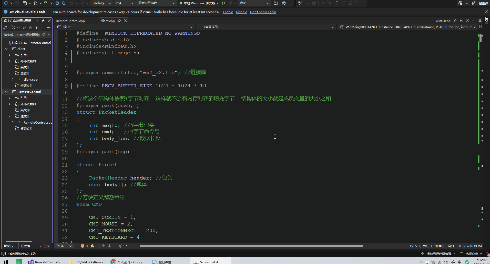
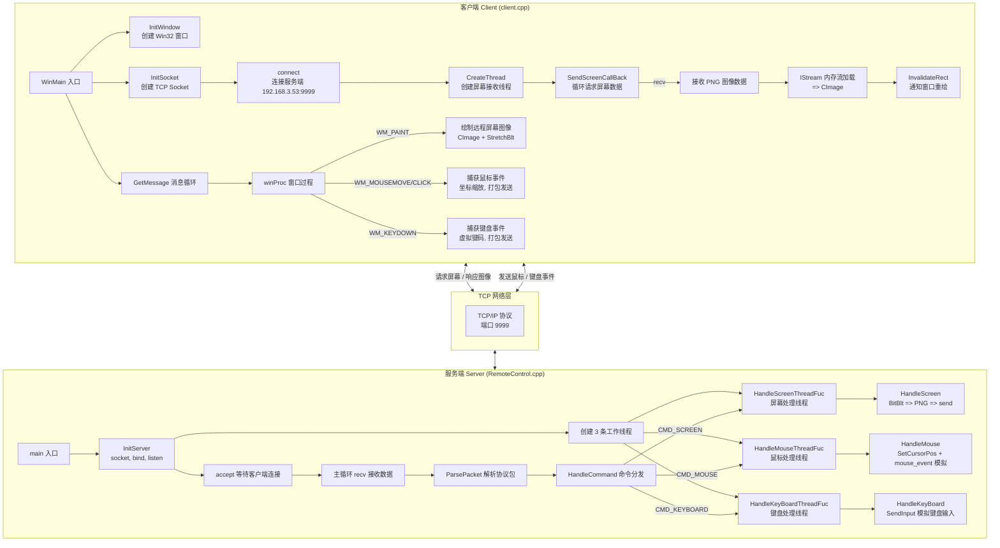
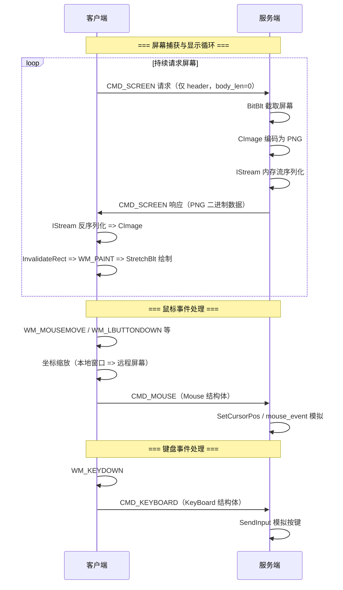
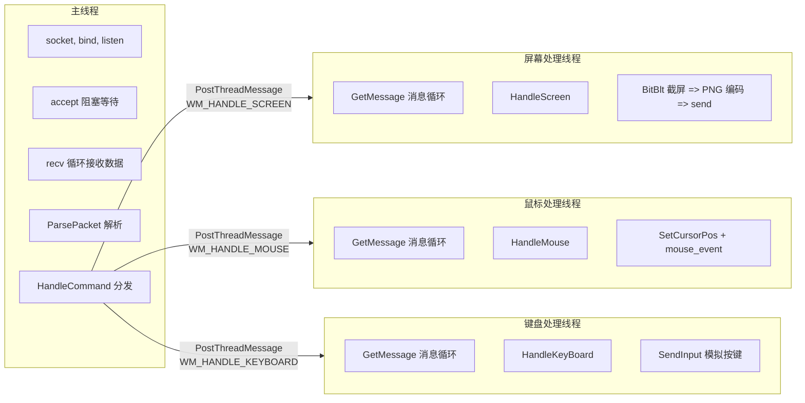
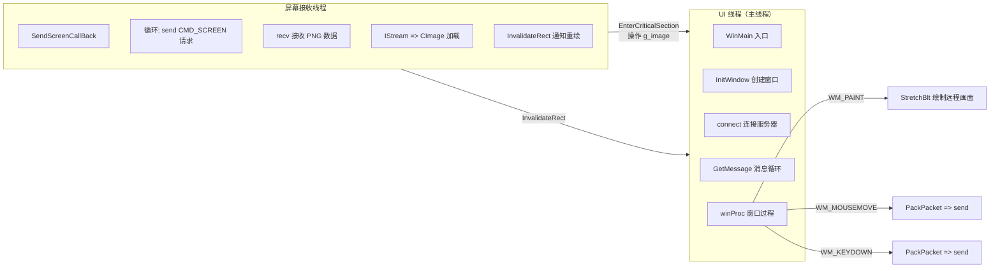

# RemoteControl - 基于 C++/WinSock 的远程桌面控制系统

## 项目运行展示

| 服务端（被控端） | 客户端（控制端） |
|:---:|:---:|
|  |  |

> **快速上手（exe 在哪、怎么启动、命令行参数、界面说明、自测脚本、常见问题）：见 [docs/USAGE.md](docs/USAGE.md)**
> 功能规划与验收记录：[docs/FEATURES_PLAN.md](docs/FEATURES_PLAN.md)

---

## 目录

- [1. 项目概述](#1-项目概述)
- [2. 系统架构](#2-系统架构)
- [3. 项目文件结构](#3-项目文件结构)
- [4. 通信协议设计](#4-通信协议设计)
- [5. 线程模型](#5-线程模型)
- [6. 核心流程详解](#6-核心流程详解)
  - [6.1 服务端流程](#61-服务端流程)
  - [6.2 客户端流程](#62-客户端流程)
  - [6.3 屏幕捕获与传输流程](#63-屏幕捕获与传输流程)
  - [6.4 鼠标/键盘事件处理流程](#64-鼠标键盘事件处理流程)
- [7. 关键技术点与 C++ 知识点](#7-关键技术点与-c-知识点)
- [8. 构建与运行](#8-构建与运行)
- [9. 待优化项](#9-待优化项)

---

## 1. 项目概述

RemoteControl 是一个基于 **C++ Win32 API + WinSock2** 实现的局域网远程桌面控制系统。系统采用 **客户端/服务端（C/S）架构**：

- **服务端（Server）**：运行在被控机器上，负责捕获屏幕图像、接收并模拟执行来自客户端的鼠标/键盘操作。
- **客户端（Client）**：运行在控制端机器上，负责请求远程屏幕图像并实时显示、捕获本地鼠标/键盘事件并发送到服务端。

**核心特性：**
- TCP 可靠传输
- 自定义二进制通信协议（魔数校验 + 命令分发）
- 多线程异步命令处理（屏幕/鼠标/键盘独立流水线）
- 屏幕图像以 PNG 格式实时压缩传输
- 支持鼠标移动、单击、双击、右键、中键全动作
- 支持键盘按键模拟
- 坐标自适应缩放（客户端窗口 → 远程屏幕）
- 高 DPI 显示器适配

---

## 2. 系统架构

### 2.1 整体架构图



### 2.2 数据流图



---

## 3. 项目文件结构

```
RemoteControl/
├── RemoteControl.slnx                 # Visual Studio 解决方案文件
├── README.md                          # 本文档
├── clientshow.gif                     # 客户端运行演示动图
├── servershow.gif                     # 服务端运行演示动图
│
├── client/                            # 客户端项目
│   ├── client.cpp                     # 客户端核心源码（~740 行）
│   ├── client.vcxproj                 # VS 项目文件
│   ├── client.vcxproj.filters         # VS 文件过滤器
│   └── x64/Debug/                     # 编译产物
│       └── client.exe
│
└── RemoteControl/                     # 服务端项目
    ├── RemoteControl.cpp              # 服务端核心源码（~530 行）
    ├── RemoteControl.vcxproj          # VS 项目文件
    ├── RemoteControl.vcxproj.filters  # VS 文件过滤器
    ├── test.png                       # 测试截屏文件
    └── x64/Debug/
        ├── RemoteControl.exe          # 服务端可执行文件
        └── RemoteControl.pdb          # 调试符号
```

---

## 4. 通信协议设计

### 4.1 协议结构

系统自定义了一套简单的二进制通信协议：

```
+----------------+----------------+----------------+----------------+
|    magic (4B)  |    cmd (4B)    |  body_len (4B) |  body (变长)   |
+----------------+----------------+----------------+----------------+
|   0x12345678   |   命令号       |   数据长度      |   数据内容      |
+----------------+----------------+----------------+----------------+
                 |<------- PacketHeader (12 字节) -------->|
                 |<-------------- Packet (12 + body_len 字节) ------------->|
```

### 4.2 结构体定义

```cpp
// 1 字节对齐，消除填充字节，确保跨平台兼容
#pragma pack(push, 1)
struct PacketHeader {
    int magic;       // 魔数 0x12345678，用于校验和数据边界识别
    int cmd;         // 命令号
    int body_len;    // 数据体长度
};
#pragma pack(pop)

struct Packet {
    PacketHeader header;  // 包头
    char body[];          // 柔性数组：不占结构体大小，动态分配
};
```

### 4.3 命令号枚举

| 命令号 | 枚举名 | 值 | 说明 | 方向 |
|--------|--------|-----|------|------|
| `CMD_SCREEN` | 屏幕数据 | 1 | 请求或响应屏幕图像数据 | 客户端→服务端（请求）/ 服务端→客户端（响应） |
| `CMD_MOUSE` | 鼠标事件 | 2 | 鼠标动作 + 坐标 | 客户端→服务端 |
| `CMD_KEYBOARD` | 键盘事件 | 4 | 虚拟键码 + 按下/抬起状态 | 客户端→服务端 |
| `CMD_TESTCONNECT` | 测试连接 | 200 | 连接性测试（预留） | 双向 |

### 4.4 数据子结构

**鼠标事件结构：**
```cpp
struct Mouse {
    int action;     // 鼠标行为（移动/按下/抬起/单击/双击）
    POINT ptXY;     // 屏幕坐标 (x, y)
};
```

**鼠标动作枚举（共 13 种）：**
| 枚举值 | 常量名 | 说明 |
|--------|--------|------|
| 1 | `MOUSE_MOVE` | 鼠标移动 |
| 2 | `MOUSE_LDOWN` | 左键按下 |
| 3 | `MOUSE_LUP` | 左键抬起 |
| 4 | `MOUSE_RDOWN` | 右键按下 |
| 5 | `MOUSE_RUP` | 右键抬起 |
| 6 | `MOUSE_MDOWN` | 中键按下 |
| 7 | `MOUSE_MUP` | 中键抬起 |
| 8 | `MOUSE_LCLICK` | 左键单击 |
| 9 | `MOUSE_RCLICK` | 右键单击 |
| 10 | `MOUSE_MCLICK` | 中键单击 |
| 11 | `MOUSE_LDCLICK` | 左键双击 |
| 12 | `MOUSE_RDCLICK` | 右键双击 |
| 13 | `MOUSE_MDCLICK` | 中键双击 |

**键盘事件结构：**
```cpp
struct KeyBoard {
    int virtual_code;  // Windows 虚拟键码 (VK_xxx)
    int key_status;    // 0 = 按下, 1 = 松开
};
```

### 4.5 协议工具函数

```cpp
// 打包：将 cmd + 数据 封装为 Packet
Packet* PackPacket(int cmd, char* buffer, int buffer_len);

// 解包：从原始缓冲区解析出 Packet（含魔数扫描定位）
Packet* ParsePacket(char* buffer, int len);

// 获取包总长度：body_len + sizeof(PacketHeader)
int GetPacketLen(Packet* pck);
```

**解包流程（魔数扫描 → 边界定位）：**
```
缓冲区数据: [... 0x12 0x34 0x56 0x78 cmd body_len body_data ...]
              ↑
              逐字节扫描直到匹配 0x12345678 → 定位包头起始位置
              → 读取 cmd (4B) → 读取 body_len (4B) → 拷贝 body 数据
```

---

## 5. 线程模型

### 5.1 服务端线程模型



**关键设计点：**

1. **线程消息队列激活**：使用 `PostThreadMessage` 发送 `WM_HANDLE_INVOKE_MSG_LOOP` 消息来激活各工作线程的消息队列（在 Windows 中，线程的消息队列在第一次调用 `GetMessage` 之前不会被创建）。

2. **异步分发**：主线程通过 `PostThreadMessage` 将解析出的 `Packet*` 指针投递到对应的工作线程消息队列，实现"接收-分发-处理"的解耦。

3. **工作线程安全释放**：各工作线程在处理完 `WM_HANDLE_*` 消息后调用 `free(packet)` 释放内存。

### 5.2 客户端线程模型



**关键设计点：**

1. **临界区保护**：`g_image` 对象由 UI 线程（读）和屏幕接收线程（写）共享访问，使用 `CRITICAL_SECTION g_cri_sec` 保护。

2. **跨线程 UI 更新**：工作线程不能直接操作 UI 控件，通过 `InvalidateRect(g_hwnd, NULL, FALSE)` + `UpdateWindow(g_hwnd)` 通知 UI 线程重绘。

3. **坐标缩放**：客户端窗口坐标按比例映射到远程屏幕坐标：
   ```cpp
   rxPos = xPos * g_remote_width  / client_width;
   ryPos = yPos * g_remote_height / client_height;
   ```

---

## 6. 核心流程详解

### 6.1 服务端流程

```
main()
├── InitServer()
│   ├── WSAStartup(2,2)           # 初始化 WinSock
│   ├── socket(AF_INET, TCP)      # 创建 TCP 套接字
│   ├── bind(0.0.0.0:9999)        # 绑定本地所有 IP
│   └── listen(5)                 # 开始监听
├── CreateThread × 3              # 创建 3 条工作线程
├── PostThreadMessage × 3         # 激活各工作线程消息队列
├── Sleep(100)                    # 等待消息队列就绪
├── accept()                      # 阻塞等待客户端连接
├── while(true):
│   ├── recv()                    # 阻塞接收数据
│   ├── 追加到缓冲区
│   ├── ParsePacket()             # 解析协议包
│   └── HandleCommand()           # 分发到对应线程处理
└── closesocket / WSACleanup      # 清理资源
```

### 6.2 客户端流程

```
WinMain()
├── InitializeCriticalSection()   # 初始化临界区
├── InitWindow()
│   ├── RegisterClass()           # 注册窗口类 "MainWindow"
│   ├── CreateWindow(800×600)     # 创建窗口 "远程控制"
│   └── ShowWindow / UpdateWindow
├── InitSocket()
│   ├── WSAStartup(2,2)
│   ├── socket()
│   └── 设置目标地址 192.168.3.53:9999
├── connect()                     # 连接服务端
├── CreateThread(SendScreenCallBack)  # 创建屏幕接收线程
└── while(GetMessage())           # 消息循环
    ├── TranslateMessage()
    └── DispatchMessage()
        └── winProc()             # 处理鼠标/键盘/绘制消息
```

### 6.3 屏幕捕获与传输流程

```mermaid
flowchart TD
    A[客户端发送 CMD_SCREEN 请求] --> B[服务端接收请求]
    B --> C[HandleScreen 被调用]
    
    C --> D[GetDC NULL 获取屏幕 DC]
    D --> E[GetDeviceCaps 获取位宽]
    E --> F[GetSystemMetrics 获取屏幕宽高]
    F --> G[CImage.Create 创建图像缓冲区]
    G --> H["BitBlt SRCCOPY<br/>屏幕像素 => CImage"]
    H --> I[ReleaseDC 释放屏幕 DC]
    
    I --> J[GlobalAlloc 申请全局内存]
    J --> K[CreateStreamOnHGlobal<br/>创建 IStream 内存流]
    K --> L["image.Save to PNG format<br/>CImage PNG 编码到流"]
    L --> M[GlobalLock 获取内存指针]
    M --> N[PackPacket 打包为 Packet]
    N --> O["send PNG data to client<br/>发送 PNG 二进制数据"]
    
    O --> P[客户端 recv 接收]
    P --> Q[ParsePacket 解包]
    Q --> R[GlobalAlloc + CreateStreamOnHGlobal]
    R --> S["pStream.Write body<br/>写入 PNG 数据到流"]
    S --> T["pStream.Seek<br/>重置流指针"]
    T --> U["EnterCriticalSection<br/>g_image.Load pStream"]
    U --> V[LeaveCriticalSection]
    V --> W["InvalidateRect + UpdateWindow<br/>触发 WM_PAINT 重绘"]
    W --> X["WM_PAINT: g_image.StretchBlt<br/>图像自适应缩放绘制"]
```



**关键技术细节：**

- **图像编码**：使用 CImage 内置的 `Gdiplus::ImageFormatPNG` 将屏幕数据压缩为 PNG 格式。PNG 是无损压缩，相比原始位图显著减小传输数据量。
- **内存流**：使用 COM 接口 `IStream` + `HGLOBAL` 全局内存块，避免文件 I/O，直接在内存中完成"位图 → PNG → 网络数据包"的转换。
- **图像加载**：客户端将接收到的 PNG 字节流通过 `IStream::Write` 写入内存流后 `CImage::Load`，无需落盘。
- **重绘机制**：`InvalidateRect` 使窗口客户区无效 → `UpdateWindow` 绕过消息队列直接发送 `WM_PAINT` → `winProc` 中 `StretchBlt` 绘制。

### 6.4 鼠标/键盘事件处理流程

```
客户端鼠标操作
├── winProc 捕获 WM_MOUSEMOVE / WM_LBUTTONDOWN / WM_RBUTTONDBLCLK 等 12 种消息
├── 提取 (xPos, yPos)
├── 坐标缩放: rxPos = xPos * remote_width / client_width
├── 构造 Mouse{action, ptXY} 结构体
├── PackPacket(CMD_MOUSE, &mouse, sizeof(Mouse))
├── send() 发送
│
└── 服务端接收
    ├── HandleMouse 被调用
    ├── memcpy 解析 Mouse 结构体
    ├── SetCursorPos 设置鼠标位置
    └── switch(action):
        ├── MOUSE_MOVE → SetCursorPos
        ├── MOUSE_LDOWN → mouse_event(LEFTDOWN)
        ├── MOUSE_LUP   → mouse_event(LEFTUP)
        ├── MOUSE_LCLICK→ mouse_event(LEFTDOWN | LEFTUP)
        ├── MOUSE_LDCLICK → mouse_event × 2
        └── ...

客户端键盘操作
├── winProc 捕获 WM_KEYDOWN / WM_SYSKEYDOWN
├── 提取 wParam（虚拟键码）
├── 构造 KeyBoard{virtual_code, key_status=0}
├── PackPacket(CMD_KEYBOARD, &keyboard, sizeof(KeyBoard))
├── send() 发送
│
└── 服务端接收
    ├── HandleKeyBoard 被调用
    ├── memcpy 解析 KeyBoard 结构体
    ├── 填充 INPUT 结构体
    └── SendInput(1, &input, sizeof(INPUT))
```

---

## 7. 关键技术点与 C++ 知识点

### 7.1 网络编程 — WinSock2

```cpp
#pragma comment(lib, "ws2_32.lib")   // 链接 WinSock 库

// 初始化 WinSock
WSADATA wsaData;
WSAStartup(MAKEWORD(2, 2), &wsaData);

// 创建套接字
SOCKET s = socket(AF_INET, SOCK_STREAM, 0);  // IPv4, TCP

// 服务端绑定与监听
SOCKADDR_IN addr;
addr.sin_family = AF_INET;
addr.sin_port = htons(9999);           // 端口 9999
addr.sin_addr.S_un.S_addr = INADDR_ANY; // 绑定所有 IP
bind(s, (SOCKADDR*)&addr, sizeof(addr));
listen(s, 5);                          // 最大 5 个连接等待

// 客户端连接
addr.sin_addr.S_un.S_addr = inet_addr("192.168.3.53");
connect(s, (SOCKADDR*)&addr, sizeof(addr));

// 发送与接收
send(s, buffer, len, 0);
recv(s, buffer, buffer_size, 0);

// 清理
closesocket(s);
WSACleanup();
```

| 知识点 | 说明 |
|--------|------|
| **TCP vs UDP** | 项目使用 TCP（可靠、有序、面向连接），适合屏幕数据传输的完整性要求 |
| **网络字节序** | `htons()` 将主机字节序转为网络字节序（大端），端口号必须转换 |
| **阻塞式 I/O** | `accept`/`recv` 默认阻塞，等待数据到达才返回 |
| **INADDR_ANY** | 服务端绑定所有本地 IP 地址，局域网任何网卡均可连接 |

### 7.2 内存对齐与柔性数组

```cpp
// 1 字节对齐：消除编译器自动填充，确保结构体跨平台二进制一致
#pragma pack(push, 1)
struct PacketHeader {
    int magic;       // 偏移 0, 4 字节
    int cmd;         // 偏移 4, 4 字节
    int body_len;    // 偏移 8, 4 字节
};                   // 总大小 12 字节（无填充）
#pragma pack(pop)

// 柔性数组（Flexible Array Member）
struct Packet {
    PacketHeader header;  // 12 字节
    char body[];          // 不占空间！实际大小由 malloc 决定
};
// 分配: malloc(sizeof(PacketHeader) + body_len)
// body 指针指向 header 之后的内存区域
```

| 知识点 | 说明 |
|--------|------|
| **`#pragma pack`** | 控制结构体字节对齐方式；`push/pop` 保存/恢复原有对齐设置 |
| **内存对齐** | 默认对齐下 `int` 需 4 字节边界，结构体可能有填充字节 |
| **柔性数组** | C99/C++ 特性，`char body[]` 作为结构体最后一个成员，不占结构体空间，实现变长数据包 |
| **二进制兼容** | 1 字节对齐保证不同编译器/平台下结构体二进制布局一致 |

### 7.3 多线程编程

```cpp
// 临界区（轻量级同步对象）
CRITICAL_SECTION g_cri_sec;
InitializeCriticalSection(&g_cri_sec);
EnterCriticalSection(&g_cri_sec);
// ... 临界区代码 ...
LeaveCriticalSection(&g_cri_sec);

// 创建线程
HANDLE h = CreateThread(
    NULL,        // 安全属性
    0,           // 栈大小（0 = 默认）
    ThreadFunc,  // 线程函数
    NULL,        // 参数
    0,           // 创建标志（0 = 立即执行）
    &thread_id   // 接收线程 ID
);

// 线程间消息通信
PostThreadMessage(thread_id, WM_USER + 1, wParam, lParam);
```

| 知识点 | 说明 |
|--------|------|
| **CRITICAL_SECTION** | 用户态同步对象，比 Mutex 更轻量，适合进程内线程同步 |
| **CreateThread** | Windows API 创建线程，返回句柄 |
| **PostThreadMessage** | 向指定线程的消息队列投递消息，实现线程间异步通信 |
| **线程消息队列** | Windows 线程在首次调用 `GetMessage`/`PeekMessage` 时才创建消息队列 |
| **UI 线程限制** | 只有创建窗口的线程才能安全操作该窗口的 UI（单线程 GUI 模型） |

### 7.4 Win32 GUI 编程

```cpp
// 窗口类注册
WNDCLASS wc = { 0 };
wc.lpfnWndProc = winProc;              // 消息处理函数
wc.hInstance = hInstance;
wc.lpszClassName = "MainWindow";
wc.hbrBackground = (HBRUSH)GetStockObject(WHITE_BRUSH);
wc.hCursor = LoadCursor(NULL, IDC_ARROW);
wc.style = CS_HREDRAW | CS_VREDRAW;    // 尺寸变化时重绘
RegisterClass(&wc);

// 窗口创建
HWND hwnd = CreateWindow("MainWindow", "远程控制",
    WS_OVERLAPPEDWINDOW,
    CW_USEDEFAULT, CW_USEDEFAULT,
    800, 600, NULL, NULL, hInstance, NULL);

// 消息循环
MSG msg;
while (GetMessage(&msg, NULL, 0, 0)) {
    TranslateMessage(&msg);
    DispatchMessage(&msg);
}

// 窗口过程
LRESULT CALLBACK winProc(HWND hwnd, UINT msg, WPARAM wParam, LPARAM lParam) {
    switch (msg) {
    case WM_PAINT:       // 绘制
    case WM_MOUSEMOVE:   // 鼠标移动
    case WM_LBUTTONDOWN: // 左键按下
    case WM_KEYDOWN:     // 键盘按下
    // ...
    }
}
```

| 知识点 | 说明 |
|--------|------|
| **窗口类 (WNDCLASS)** | 定义窗口的"模板"，包括样式、图标、光标、消息处理函数等 |
| **消息驱动模型** | Windows GUI 是事件驱动，所有操作由消息循环分发 |
| **WM_PAINT** | 窗口需要重绘时发送；使用 `BeginPaint`/`EndPaint` 配对处理 |
| **WM_MOUSEMOVE** | `lParam` 低字为 x，高字为 y；`LOWORD`/`HIWORD` 宏提取坐标 |
| **虚拟键码** | 键盘消息中 `wParam` 是虚拟键码（`VK_RETURN`、`VK_SPACE` 等） |

### 7.5 GDI 图形编程 — 屏幕捕获

```cpp
// 获取屏幕设备上下文
HDC hScreen = GetDC(NULL);

// 获取设备参数
int bitWidth = GetDeviceCaps(hScreen, BITSPIXEL);  // 像素位宽
int sWidth = GetSystemMetrics(SM_CXSCREEN);          // 屏幕宽度
int sHeight = GetSystemMetrics(SM_CYSCREEN);          // 屏幕高度

// 创建图像缓存
CImage image;
image.Create(sWidth, sHeight, bitWidth);

// 屏幕像素复制
BitBlt(
    image.GetDC(),   // 目标 DC
    0, 0,            // 目标左上角
    sWidth, sHeight, // 目标宽高
    hScreen,         // 源 DC
    0, 0,            // 源左上角
    SRCCOPY          // 操作类型：直接拷贝
);

// 释放资源
image.ReleaseDC();
ReleaseDC(NULL, hScreen);
```

| 知识点 | 说明 |
|--------|------|
| **设备上下文 (DC)** | Windows 的图形抽象层，所有绘制操作通过 DC 完成 |
| **BitBlt** | 位图块传输（Bit Block Transfer），将像素矩形从源复制到目标 |
| **SRCCOPY** | 光栅操作码，表示直接覆盖拷贝（不混合） |
| **GetDC(NULL)** | 获取整个屏幕的 DC（NULL 表示桌面窗口） |
| **DPI 感知** | `SetProcessDpiAwarenessContext` 使进程感知每个显示器的 DPI |

### 7.6 CImage (ATL) 图像处理

```cpp
#include <atlimage.h>

CImage image;

// 从 DC 创建
image.Create(width, height, bitWidth);

// 保存到流（内存）
IStream* pStream;
CreateStreamOnHGlobal(hGlobal, TRUE, &pStream);
image.Save(pStream, Gdiplus::ImageFormatPNG);  // PNG 编码

// 从流加载
image.Load(pStream);

// 缩放绘制
image.StretchBlt(hdc,
    dstX, dstY, dstW, dstH,   // 目标矩形
    srcX, srcY, srcW, srcH,   // 源矩形
    SRCCOPY
);

// 获取图像信息
int w = image.GetWidth();
int h = image.GetHeight();
BOOL isNull = image.IsNull();
```

| 知识点 | 说明 |
|--------|------|
| **CImage** | ATL 封装的图像类，支持 BMP/PNG/JPEG/GIF 等多种格式 |
| **Gdiplus** | CImage 底层使用 GDI+ 进行 PNG 编解码 |
| **StretchBlt** | 拉伸模式图像绘制，`HALFTONE` 模式实现高质量缩放 |
| **`SetStretchBltMode`** | 设置拉伸质量：`HALFTONE`(高质量) / `COLORONCOLOR`(快速) |
| **`SetBrushOrgEx`** | 配合 HALFTONE 模式使用，设置画刷对齐原点 |

### 7.7 COM 接口 — IStream 内存流

```cpp
// 从堆分配可移动的全局内存块
HGLOBAL hMem = GlobalAlloc(GMEM_MOVEABLE, 0);

// 在全局内存上创建 COM 流对象
IStream* pStream = NULL;
CreateStreamOnHGlobal(hMem, TRUE, &pStream);  // TRUE = 自动释放 HGLOBAL

// 写数据到流
ULONG written;
pStream->Write(data, dataSize, &written);

// 重置流指针到开头
LARGE_INTEGER pos = { 0 };
pStream->Seek(pos, STREAM_SEEK_SET, NULL);

// 直接访问流中数据
char* ptr = (char*)GlobalLock(hMem);
int size = GlobalSize(hMem);
// ... 使用 ptr 和 size ...
GlobalUnlock(hMem);

// 释放流
pStream->Release();
```

| 知识点 | 说明 |
|--------|------|
| **COM 接口** | `IStream` 是 COM（Component Object Model）接口，通过 `Release()` 管理引用计数 |
| **HGLOBAL** | Windows 全局堆内存句柄，`GMEM_MOVEABLE` 表示内存可移动 |
| **CreateStreamOnHGlobal** | 将 HGLOBAL 封装为 COM 流，方便与 CImage 等 COM 感知类互操作 |
| **Seek** | 流指针定位，`STREAM_SEEK_SET` 从开头偏移 |

### 7.8 鼠标/键盘模拟

```cpp
// 设置光标位置
SetCursorPos(x, y);

// 模拟鼠标事件
mouse_event(MOUSEEVENTF_LEFTDOWN, 0, 0, 0, GetMessageExtraInfo());
mouse_event(MOUSEEVENTF_LEFTUP,   0, 0, 0, GetMessageExtraInfo());
mouse_event(MOUSEEVENTF_RIGHTDOWN, 0, 0, 0, GetMessageExtraInfo());
// 组合标志实现单击
mouse_event(MOUSEEVENTF_LEFTDOWN | MOUSEEVENTF_LEFTUP, 0, 0, 0, GetMessageExtraInfo());

// 模拟键盘事件（SendInput 是 mouse_event 的现代替代方案）
INPUT input = { 0 };
input.type = INPUT_KEYBOARD;
input.ki.wVk = VK_RETURN;       // 虚拟键码
input.ki.dwFlags = 0;            // 0=按下, KEYEVENTF_KEYUP=松开
SendInput(1, &input, sizeof(INPUT));
```

| 知识点 | 说明 |
|--------|------|
| **`mouse_event`** | 已过时的 API，但简单场景仍广泛使用；现代代码推荐 `SendInput` |
| **`SendInput`** | 向输入栈注入键盘/鼠标/硬件事件，比 `keybd_event`/`mouse_event` 更可靠 |
| **`GetMessageExtraInfo`** | 返回当前消息的额外信息，模拟事件时作为参数传递以区分来源 |
| **虚拟键码** | Windows 定义的键盘常量 `VK_*`，与具体键盘布局无关 |

### 7.9 内存管理

```cpp
// C 标准库
void* buf = malloc(size);
free(buf);

// Windows 全局堆
HGLOBAL hMem = GlobalAlloc(GMEM_MOVEABLE, size);
void* ptr = GlobalLock(hMem);
// ... 使用 ptr ...
GlobalUnlock(hMem);
GlobalFree(hMem);

// COM 内存
CoTaskMemAlloc / CoTaskMemFree

// C++ (未在项目中使用，但值得了解)
void* buf = new char[size];
delete[] buf;
```

### 7.10 预处理器指令

```cpp
#define _WINSOCK_DEPRECATED_NO_WARNINGS  // 消除 WinSock 废弃 API 警告
#define RECV_BUFFER_SIZE 1024 * 1024 * 10  // 10MB 接收缓冲区

#pragma comment(lib, "ws2_32.lib")       // 链接时自动引用库
#pragma pack(push, 1)                    // 保存对齐设置，设置 1 字节对齐
#pragma pack(pop)                        // 恢复之前的对齐设置
```

---

## 8. 构建与运行

### 8.1 环境要求

| 组件 | 要求 |
|------|------|
| 操作系统 | Windows 10/11 x64 |
| 编译器 | Visual Studio 2022 (v143 工具集) |
| Windows SDK | 10.0+ |
| 依赖库 | `ws2_32.lib`（WinSock2）、ATL/MFC（CImage 依赖） |
| 运行时 | VC++ 可再发行组件包 |

### 8.2 构建步骤

1. **打开解决方案**：双击 `RemoteControl.slnx` 在 Visual Studio 中打开。
2. **选择配置**：Debug x64（调试）或 Release x64（发布）。
3. **生成解决方案**：`生成 → 生成解决方案 (Ctrl+Shift+B)`。
4. **编译产物**：
   - 服务端：`RemoteControl/x64/Debug/RemoteControl.exe`
   - 客户端：`client/x64/Debug/client.exe`

### 8.3 运行步骤

1. **启动服务端**（被控机器）：运行 `RemoteControl.exe`
   ```
   等待客户端连接...
   客户端连接成功！
   ```
2. **启动客户端**（控制端机器）：运行 `client.exe`
   - 弹出窗口 `"远程控制"`，实时显示被控端的桌面画面。
   - 在窗口中进行鼠标操作（点击、拖动、滚动）和键盘输入，将实时转发到服务端执行。

### 8.4 配置说明

- **服务端 IP 地址**：目前硬编码为 `192.168.3.53`（[client.cpp L722](client/client.cpp#L722)），根据实际网络环境修改。
- **服务端端口**：`9999`（[RemoteControl.cpp L506](RemoteControl/RemoteControl.cpp#L506)），如需修改请同时修改服务端和客户端。
- **接收缓冲区**：`RECV_BUFFER_SIZE = 10 MB`，可按需调整。
- **窗口大小**：客户端窗口默认 `800×600`，可拉伸缩放。

---

## 9. 待优化项

| 优先级 | 项目 | 说明 |
|--------|------|------|
| 高 | 错误处理 | `recv`/`send` 返回 ≤0 时应处理断连和错误恢复 |
| 高 | IP 配置 | 硬编码 IP，建议改为命令行参数或配置文件 |
| 高 | 内存泄漏 | 部分错误分支未释放已分配内存（如 `ParsePacket` 中 `body_len == 0` 分支） |
| 中 | 鼠标移动频率 | `WM_MOUSEMOVE` 每个像素都发送，可增加节流（已注释的 500ms 逻辑） |
| 中 | 加密传输 | 当前明文传输，局域网内部使用，公网场景应加 TLS |
| 中 | 多客户端支持 | 服务端仅支持单客户端，可扩展为多客户端并发 |
| 低 | 认证机制 | 无连接认证，任何知道端口的主机都可连接 |
| 低 | 数据压缩 | PNG 已实现无损压缩，可考虑 JPEG/WebP 的有损压缩以减少带宽 |
| 低 | 剪贴板同步 | 当前不支持剪贴板共享 |
| 低 | 文件传输 | 当前不支持文件传输功能 |
| 低 | 连接保活 | 无心跳机制，长连接断开检测不可靠 |

---

## 知识索引

本项目涉及的 C++/Windows 核心知识点速查：

```
┌─ 网络编程
│  ├─ WinSock2 (WSAStartup/socket/connect/send/recv/accept/listen/bind)
│  ├─ TCP 协议 (SOCK_STREAM)
│  ├─ 网络字节序 (htons/ntohs)
│  └─ inet_addr/INADDR_ANY
├─ Win32 GUI
│  ├─ WinMain 入口
│  ├─ WNDCLASS/RegisterClass/CreateWindow
│  ├─ 消息循环 (GetMessage/TranslateMessage/DispatchMessage)
│  ├─ 窗口过程 (WM_PAINT/WM_MOUSEMOVE/WM_KEYDOWN...)
│  └─ LOWORD/HIWORD 坐标提取
├─ GDI 图形
│  ├─ DC 设备上下文 (GetDC/ReleaseDC/BeginPaint/EndPaint)
│  ├─ BitBlt 位块传输
│  ├─ StretchBlt 拉伸绘制
│  └─ SetStretchBltMode/SetBrushOrgEx
├─ CImage (ATL)
│  ├─ Create/Load/Save
│  ├─ StretchBlt
│  └─ GetWidth/GetHeight/IsNull
├─ COM
│  ├─ IStream 接口
│  ├─ CreateStreamOnHGlobal
│  ├─ HGLOBAL/GlobalAlloc/GlobalLock/GlobalUnlock
│  └─ Release 引用计数
├─ 多线程
│  ├─ CreateThread
│  ├─ CRITICAL_SECTION (Enter/Leave)
│  ├─ PostThreadMessage 线程通信
│  └─ 线程消息队列激活
├─ 内存管理
│  ├─ malloc/free
│  ├─ memcpy/memmove
│  └─ 柔性数组 (char body[])
├─ 结构体对齐
│  ├─ #pragma pack(push, 1) / #pragma pack(pop)
│  └─ 内存对齐原理
├─ 输入模拟
│  ├─ SetCursorPos
│  ├─ mouse_event (MOUSEEVENTF_*)
│  └─ SendInput (INPUT/KEYBDINPUT)
└─ 预处理器
   ├─ #pragma comment(lib, ...)
   ├─ #define 宏
   └─ #pragma pack
```
